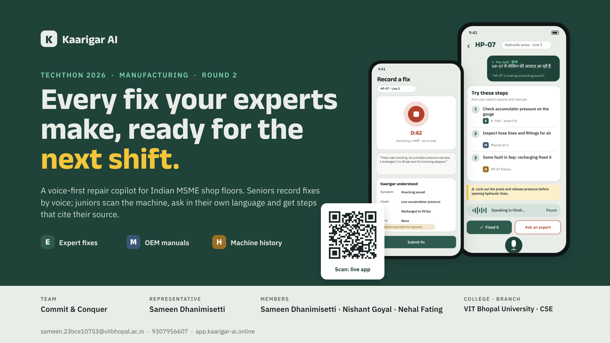
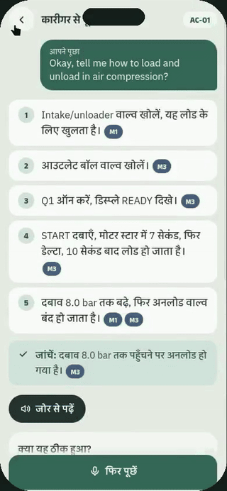
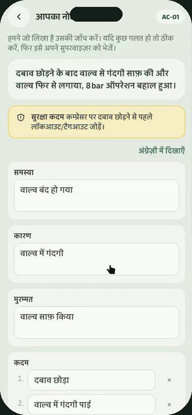
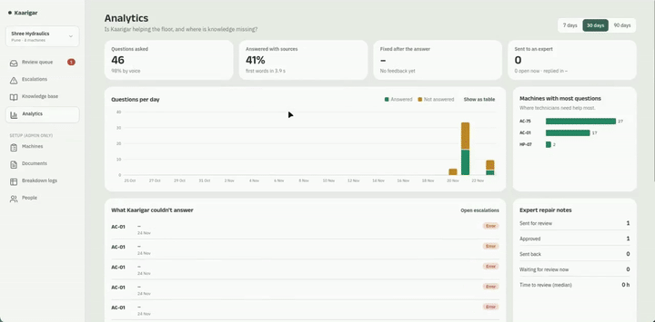
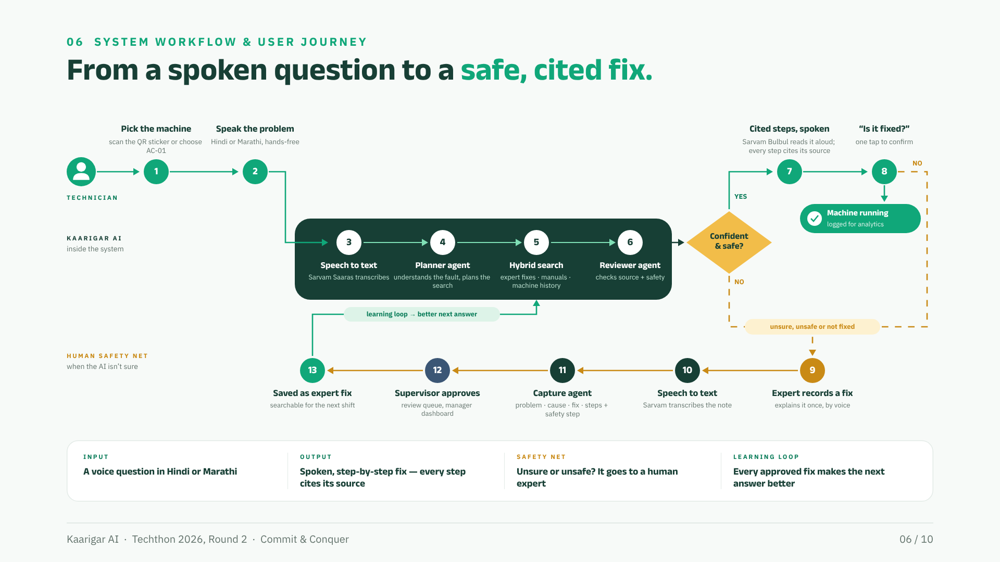
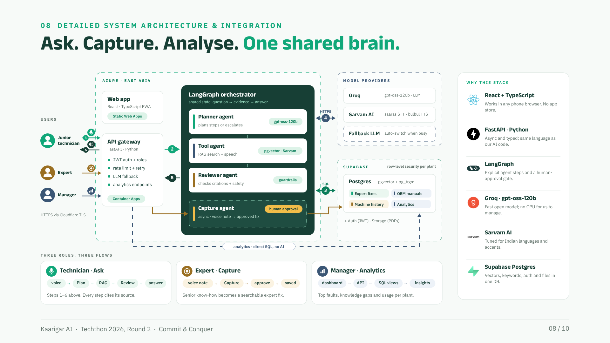
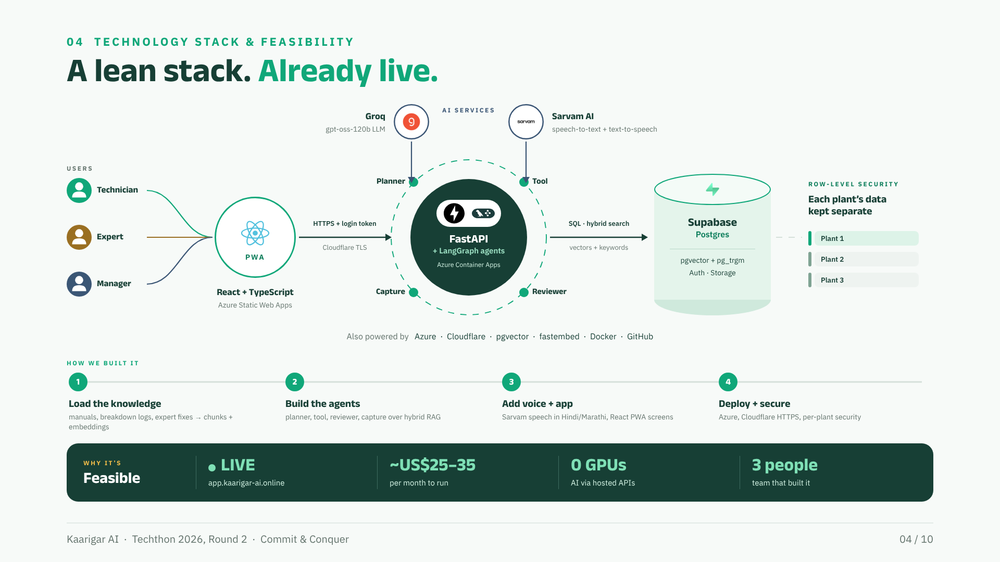
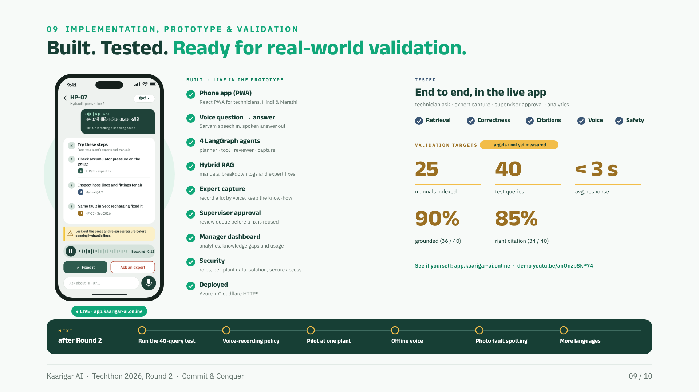
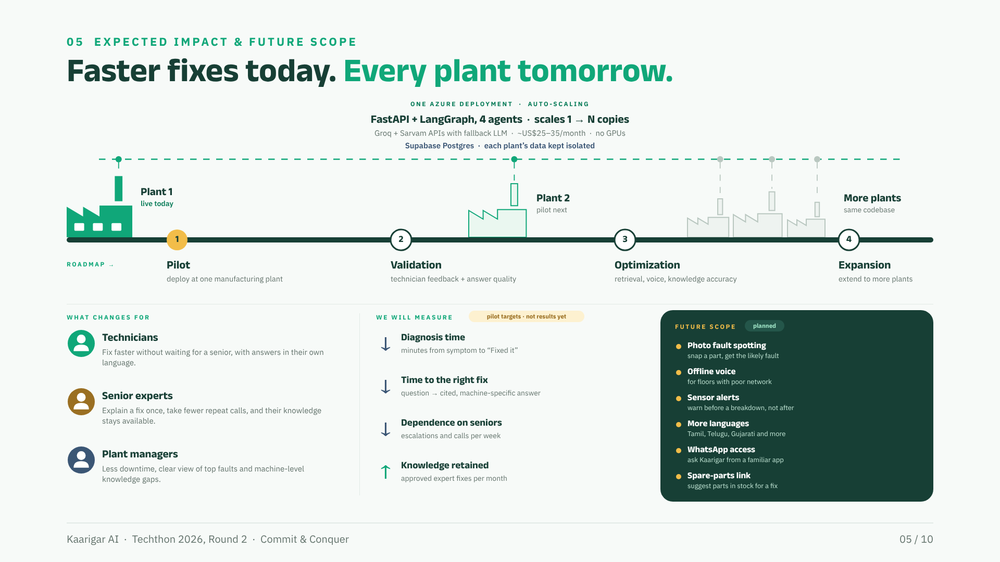

<div align="center">

# Kaarigar AI

### Every fix your experts make, ready for the next shift.

A **voice-first repair copilot** for Indian MSME shop floors. Senior technicians record fixes by voice; junior technicians ask about a machine fault in **their own language** (10 Indian languages plus English are enabled, including Hindi and Marathi) and get cited, step-by-step instructions. Answers with no valid source are refused, and low-confidence questions are flagged for escalation to a human expert.

[**Live app**](https://app.kaarigar-ai.online) · [**Demo video**](https://www.youtube.com/watch?v=anOnzpSkP74) · Techthon 2026 (Visionet), Round 2




</div>

---

## The problem

In small factories, most repair know-how lives in the heads of a few senior technicians. When a senior isn't on the shift, a junior facing a broken machine guesses, waits or calls someone, and the machine stays down. Manuals are long, mostly in English and slow to search on a noisy floor.

## The idea: capture once, reuse across every shift

| Mode | Who | What happens |
|---|---|---|
| **Capture** | Senior expert | Records a fix by voice. AI structures it (symptom · cause · fix · steps · safety note). A supervisor approves it before it's reused. |
| **Assist** | Junior technician | Scans the machine's QR sticker, asks by voice, and hears cited, step-by-step instructions in their own language. |
| **Analyse** | Supervisor / manager | Approves fixes, uploads manuals, imports breakdown logs and sees top faults and knowledge gaps. |

---

## See it in action

<table>
<tr>
<td align="center" width="25%"><br><b>Technician asks</b><br><sub>sign in → AC-01 → voice question → cited steps</sub></td>
<td align="center" width="25%"><br><b>Expert captures</b><br><sub>voice note → structured fix + safety step → sent for approval</sub></td>
<td align="center" width="50%"><br><b>Manager approves & analyses</b><br><sub>review queue → knowledge → analytics → people</sub></td>
</tr>
</table>

---

## How it works



**Ask (technician):** ① pick the machine → ② speak the problem → ③ speech-to-text (Sarvam Saaras) → ④ understand / normalise the question → ⑤ hybrid search → ⑥ grounded answer writer → **cited & confident?** → ⑦ cited steps, spoken (Sarvam Bulbul) → ⑧ "Is it fixed?"

**Safety net (expert + supervisor):** if the answer is low-confidence, has no source, or didn't fix it → ⑨ expert records a fix → ⑩ speech-to-text → ⑪ LangGraph capture workflow → ⑫ expert checks the note → ⑬ supervisor approves → ⑭ saved as an expert fix, searchable for the next shift. That's the **learning loop**.

### Three knowledge sources

| Tag | Source | How it gets in | Trusted for |
|---|---|---|---|
| **E** | Expert fixes | Voice capture + **supervisor approval** | The practical fix that worked on this machine |
| **M** | OEM manuals, SOPs, safety docs | PDF upload (split by headings, page numbers kept) | Safety rules and specifications |
| **H** | Machine history | Breakdown registers imported from Excel / CSV | What failed before, how often, what fixed it |

### Hybrid search

Search **finds** evidence; it doesn't decide the answer. Every query is filtered by plant (`tenant_id`) and, when a machine is selected, by its model; hits from the same machine get a small bonus. The retrievers are:

- **Vector search** (`pgvector`, fastembed `bge-small` embeddings): same meaning, different words ("not loading" ≈ "unloader valve stuck").
- **Keyword search** (Postgres full-text + `pg_trgm`): exact error codes, part numbers, machine IDs.
- **Symptom graph:** known symptoms → approved fixes and this machine's recent breakdowns.

The lists are merged with **Reciprocal Rank Fusion**. The answer writer may use **only** the retrieved passages, and the prompt requires every step to carry a source ref; refs are checked against the retrieved set, and an answer with no valid citation is saved as `no_answer`. Safety steps are rendered first. If confidence is below the threshold or there are no sources, the app suggests escalating to a human expert instead of guessing.

---

## Architecture



| Layer | Technology |
|---|---|
| Frontend | React + TypeScript PWA (10 Indian languages + English), Azure Static Web Apps |
| Backend | Python, FastAPI, Azure Container Apps |
| Workflows | **Assist:** staged pipeline (understand → hybrid search → grounded write → citation/confidence check). **Capture:** LangGraph graph (transcribe → extract → link → check → localize → expert review → supervisor approval), checkpointed in Postgres |
| LLM | Groq `gpt-oss-120b` for answers; fallback chain Groq `gpt-oss-20b` → Mistral → Gemini → OpenRouter (only when keyed). Capture extraction uses Groq structured outputs |
| Speech | Sarvam AI: Saaras (speech → text), Bulbul (text → speech); optional fallbacks to Groq Whisper / Azure Speech / Deepgram and Azure / browser TTS |
| Data | Supabase Postgres + `pgvector` + `pg_trgm`, Auth, private Storage |
| Network | Cloudflare DNS + HTTPS |

> The architecture slide is from the Round 2 pitch and uses the original four-agent framing. In this repo, LangGraph runs the **Capture** workflow; the **Assist** path is a staged pipeline. Splitting Assist into explicit Planner / Tool / Reviewer agents is on the Next list.

<details>
<summary><b>Tech stack & feasibility slide</b></summary>
<br>

</details>

**Runs on about US$25–35/month at pilot scale with no GPUs.** All heavy AI runs through hosted APIs.

---

## Security & safety

- **Role-based access:** technician, expert, supervisor; role checks on protected API routes (the manager area additionally requires supervisor, and admin actions require admin).
- **Per-plant isolation:** tenant-scoped tables, Postgres **row-level security** read policies, and an explicit `tenant_id` filter in every backend query (the backend uses a privileged connection, so it does not rely on RLS alone).
- **Secrets stay on the server:** Groq, Sarvam and database keys live only in the backend, never in the frontend bundle or git.
- **Human in the loop:** no expert fix is reused until a supervisor approves it.
- **Safety first:** safety steps render before repair steps; answers with no valid citation are refused, low-confidence answers are flagged for escalation, and capture's AI check flags unsafe or missing safety steps for the expert.

---

## Project status



| ✅ Built and live | 🧪 Validation | 🔜 Next |
|---|---|---|
| Phone PWA (10 Indian languages + English), voice question → spoken cited answer, hybrid RAG over E/M/H, LangGraph capture workflow with expert + supervisor checkpoints, staged assist pipeline, supervisor approval, manager dashboard, roles + per-plant isolation, Azure + Cloudflare deployment | Tested end to end in the live app (technician, expert and manager flows) | Run the 40-query evaluation and publish real numbers, split Assist into explicit Planner / Tool / Reviewer LangGraph agents, voice-recording retention policy, pilot at one plant, offline voice, photo fault spotting, additional languages beyond the 10 Indian languages enabled |

> **Validation targets, not yet measured:** 25 manuals indexed · 40 test queries · 90% grounded answers (36/40) · 85% correct citations (34/40) · < 3 s average response.

<details>
<summary><b>Impact, roadmap & future scope</b></summary>
<br>

</details>

---

## Running locally

**Prerequisites:** Node.js 20+, Python 3.11+, Docker (optional), a Supabase project, and Groq + Sarvam API keys. The migrations create the `vector`, `pg_trgm` and `pgcrypto` extensions. `cloudflared` is only needed for phone testing over HTTPS.

```bash
# 1. Clone
git clone https://github.com/sam1dh/kaarigar-ai.git
cd kaarigar-ai

# 2. Environment files (git-ignored; never commit them)
cp .env.example .env
cp frontend/.env.example frontend/.env
# Fill in Supabase, Groq, Sarvam and SEED_ADMIN_PASSWORD in .env.

# 3. Backend (FastAPI, from the repo root)
python -m venv .venv
source .venv/bin/activate            # Windows: .venv\Scripts\activate
pip install -r backend/requirements.txt
uvicorn --app-dir backend app.main:app --reload   # http://localhost:8000/health

# 4. Database schema (runs all supabase/migrations/*.sql in order)
python backend/scripts/run_migrations.py

# 5. Demo plant + knowledge (both idempotent)
python backend/scripts/seed.py
python backend/scripts/seed_knowledge.py   # first run downloads the embedding model (~70 MB)

# 6. Frontend (Vite + React PWA)
cd frontend
npm install
npm run dev                          # http://localhost:5173
```

`/api` on `:5173` is proxied to the backend on `:8000` by `frontend/vite.config.ts`. Other frontend scripts: `npm run build`, `npm run preview`, `npm run lint`, `npm run format`, `npm run i18n:check`, plus `npm run dev:phone`, `npm run phone` and `npm run tunnel` for phone testing (the tunnel needs the git-ignored `.tunnel-token`).

**Docker (backend only):**

```bash
cp .env.example .env
docker compose up --build
```

Supabase itself stays in the cloud. The compose service mounts `backend/app` for reload and uses `uvicorn app.main:app` on port `8000`.

`seed.py` creates the Shree Hydraulics demo plant: technician `SH-0412` / PIN `482913`, expert `SH-0107` / PIN `261847`; the supervisor signs in at the web app as `suresh@shreehydraulics.in` with `SEED_ADMIN_PASSWORD` from `.env`.

Backend settings are read from `.env` (`backend/app/core/config.py` and the `settings.py` modules). The main names are `SUPABASE_URL`, `SUPABASE_ANON_KEY`, `SUPABASE_SERVICE_ROLE_KEY`, `DATABASE_URL`, `GROQ_API_KEY`, `SARVAM_API_KEY`, `SEED_ADMIN_PASSWORD`, `ALLOWED_ORIGINS` and `PUBLIC_APP_URL`. Optional provider fallbacks (`MISTRAL_API_KEY`, `GEMINI_API_KEY`, `OPENROUTER_API_KEY`, `AZURE_SPEECH_KEY`, `AZURE_SPEECH_REGION`, `DEEPGRAM_API_KEY`) are documented in `deploy/backend.env.production.example`. The frontend reads only `VITE_SUPABASE_URL`, `VITE_SUPABASE_ANON_KEY`, `VITE_API_URL` and `VITE_PLANT_CODE` (see `frontend/.env.example`).

## Deploy

Both scripts read git-ignored files from `deploy/` and are run from the repo root:

```bash
# Backend → Azure Container Registry + Azure Container Apps
cp deploy/azure.conf.example deploy/azure.conf
cp deploy/backend.env.production.example deploy/.env.production
./deploy/deploy_backend.sh

# Frontend → Azure Static Web Apps
cp deploy/frontend.env.production.example deploy/frontend.env.production
# put the Static Web App deployment token in deploy/.swa-token
./deploy/deploy_frontend.sh
```

`deploy/deploy_backend.sh` builds `backend/Dockerfile` from the repo root, pushes the image to ACR and creates/updates the Container App (currently `--min-replicas 1 --max-replicas 1`). `deploy/deploy_frontend.sh` runs `npm ci && npm run build` in `frontend/` and deploys `dist/` to Azure Static Web Apps. `.github/workflows/build-backend.yml` can build and push the backend image from GitHub Actions.

**Never commit secrets.** `.env`, `deploy/.env.production`, `deploy/frontend.env.production`, `deploy/azure.conf`, `deploy/.swa-token`, `.tunnel-token` and `.cloudflare-token` are git-ignored. Only public values such as the API URL belong in `VITE_*` frontend variables.

---

## Team: Commit & Conquer · VIT Bhopal University (CSE)

| Member | Role | Owns |
|---|---|---|
| **Sameen Dhanimisetti** | AI & agents · team lead | LangGraph capture workflow, hybrid RAG, voice pipeline, safety checks |
| **Nishant Goyal** | Backend & cloud | FastAPI backend, database, security, Azure deployment |
| **Nehal Fating** | Frontend & design | Multilingual phone app, manager dashboard |

<div align="center">
<sub>Built for Techthon 2026 by Visionet · Manufacturing track</sub>
</div>
